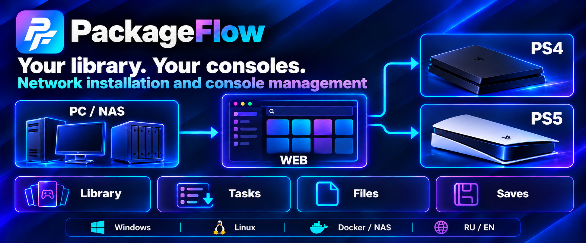
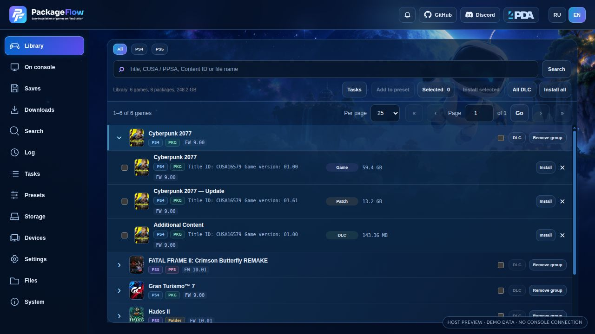
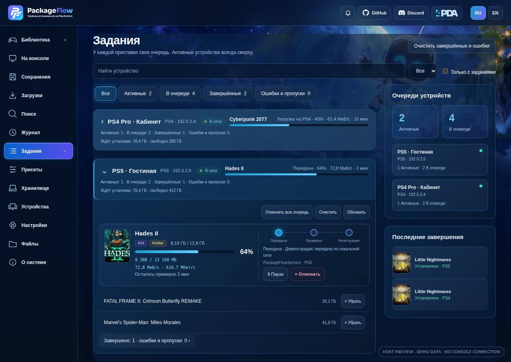
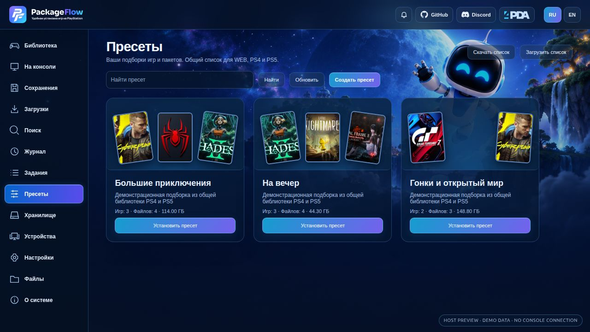
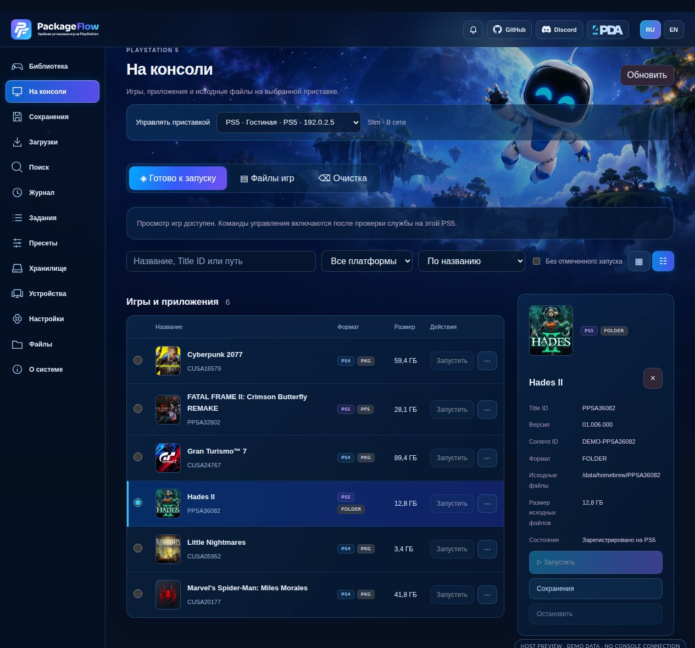
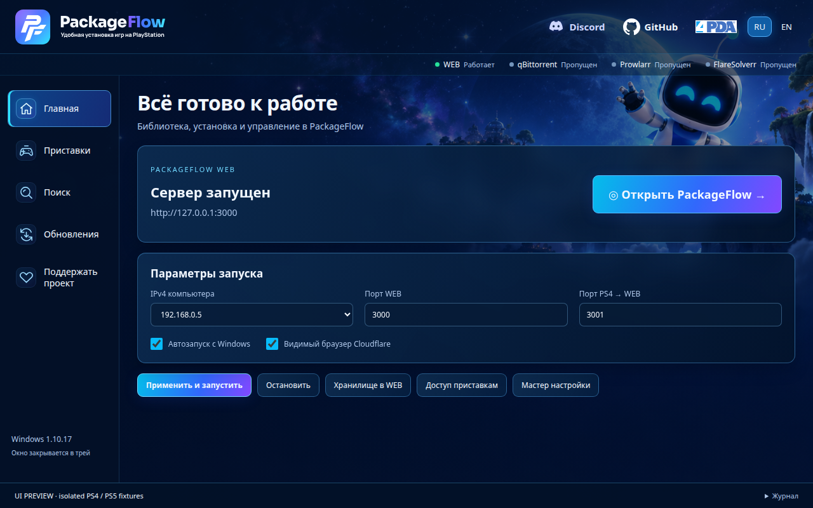
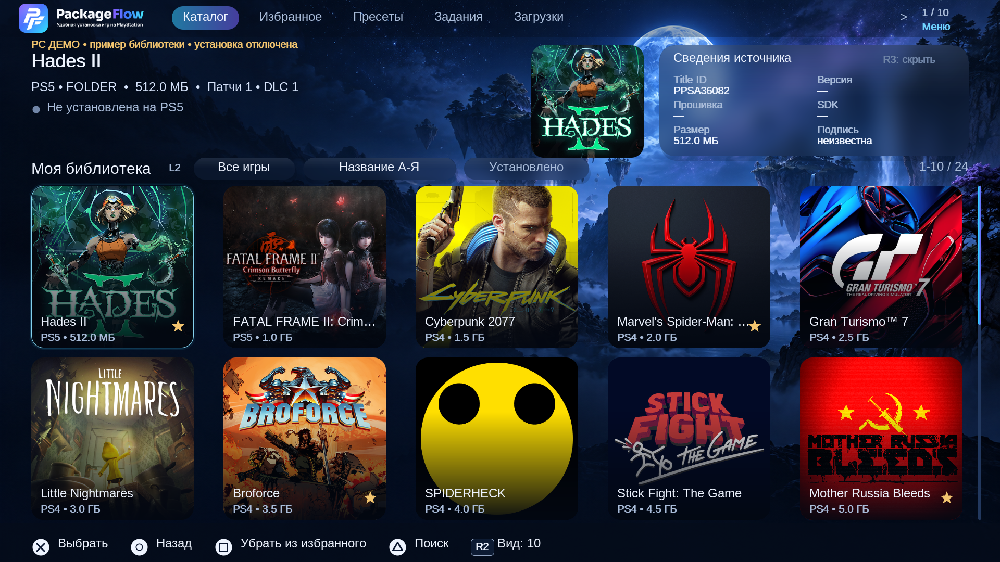

<p align="center">
  <a href="README.md">Русский</a> · <strong>English</strong>
</p>

<p align="center">
  
</p>

<h1 align="center">PackageFlow · PS4 / PS5</h1>

<p align="center">
  <strong>Your library. Your consoles.</strong><br>
  Install games, patches and DLC, manage device queues, files and saves —<br>
  from a browser on your computer or phone, or an app on your console.
</p>

<p align="center">
  <a href="https://github.com/demagoc3-cpu/playstation_installer/releases/latest"></a>
  
  
  
  <a href="LICENSE"></a>
</p>

<p align="center">
  <a href="https://github.com/demagoc3-cpu/playstation_installer/releases/latest"><strong>Download</strong></a> ·
  <a href="#installation">Installation</a> ·
  <a href="#consoles">PS4 and PS5</a> ·
  <a href="#screenshots">Screenshots</a> ·
  <a href="docs/en/index.md">Documentation</a> ·
  <a href="https://discord.gg/Xj6EPJyAq">Discord</a> ·
  <a href="https://4pda.to/forum/index.php?showtopic=1127073">4PDA</a>
</p>

---

## About

**PackageFlow** connects your library on a computer or NAS with your **PlayStation 4 and PlayStation 5** consoles. Add your game folders, choose the components and recipients, and WEB prepares the jobs while each console's service handles the transfer and installation.

One server can serve several consoles. Each has its own queue, connection and history, and you can follow them all in the browser. Manage the library from a computer, phone or tablet. The PS4 and PS5 apps provide access to the catalog and jobs with a gamepad.

[](docs/screenshots/readme-20261029/library-en.jpg)

<sub>The actual WEB interface with a demonstration library. Click the image to view it at full size.</sub>

## Features

| Area                     | Capabilities                                                                                                                                                                   |
| ------------------------ | ------------------------------------------------------------------------------------------------------------------------------------------------------------------------------ |
| **Library**              | A shared PS4/PS5 catalog with covers, metadata, search, pages and filters. Games, patches and DLC are grouped together. Your selection is kept across searches and pages.      |
| **Installation**         | Choose content and several consoles, check compatibility and free space, and confirm reinstalls. PS5 has separate routes for PKG, Folder and images.                           |
| **Tasks**                | Independent device queues, parallel operation through the services, compact cards, progress, speed and time remaining, package or game-branch cancellation, and history.       |
| **Presets**              | Create collections, edit their contents, install a collection, and import or export its list.                                                                                  |
| **Storage**              | Local directories and SMB/NFS/WebDAV network sources, folder connections, scanning and reindexing. Available connection methods depend on the OS and its components.           |
| **On console**           | A catalog of installed content, game information, launch, stop and removal, within the connected service's capabilities.                                                       |
| **Files and saves**      | PS4 file operations; PS4/PS5 save lists, backups and restoration where supported by the corresponding service.                                                                 |
| **PS5 cleanup**          | Inspect and confirm removal of PackageFlow's own leftovers: incomplete transfers, temporary data and registrations without files. Requires service 030j+ with cleanup support. |
| **Search and downloads** | Optional Prowlarr/Jackett and qBittorrent integration, torrent search, download management and automatic installation on PS4 after downloading.                                |
| **Devices and updates**  | Connect current services without a code, manage the PS5 service through PLDMGR, run speed tests and receive notifications of new PackageFlow releases.                         |
| **Russian and English**  | Switch the interface language and read the documentation in either language.                                                                                                   |

## How it works

**Files on your PC / NAS → WEB library → the selected console's queue → local installation on PS4 / PS5.**

| Component               | Role                                                                                                                                                             |
| ----------------------- | ---------------------------------------------------------------------------------------------------------------------------------------------------------------- |
| **PackageFlow WEB**     | The catalog, settings, presets, queues and file transfers. Runs on Windows, Linux or a NAS, or from source. This repository contains WEB and the desktop shells. |
| **PackageFlow for PS4** | A PKG containing the gamepad interface and the PackageFlowService background service.                                                                            |
| **PS5 ELF service**     | The background PackageFlowService-PS5.elf for transfers, installation and management. The PKG route is built into this service.                                  |
| **PS5 app**             | A separate, optional FFPKG client for the WEB library, presets and tasks.                                                                                        |

The console receives content over the local network and installs it on its own storage. The computer or NAS running WEB must remain on and reachable during a job. A NAS is a file source; playing games directly from a network folder is not claimed here.

<a id="consoles"></a>

## PS4 and PS5: formats and connections

| Recipient        | Content                                   | Requirements                                                                                                                                    |
| ---------------- | ----------------------------------------- | ----------------------------------------------------------------------------------------------------------------------------------------------- |
| **PS4**          | PS4 PKG: games, patches, DLC and homebrew | A compatible PS4 with active GoldHEN and PackageFlowService. PyLoader is available for the initial service installation and separate transfers. |
| **PS5 · PKG**    | PS4 and PS5 PKG                           | A compatible homebrew environment and a running ELF service with a ready PKG route.                                                             |
| **PS5 · Folder** | A game folder                             | The ELF service and a compatible, running ShadowMount.                                                                                          |
| **PS5 · images** | UFS2, exFAT, PFS, FFPFSC                  | The ELF service and a ShadowMount backend it supports; readiness is checked for each format.                                                    |

**PS4 cannot install PS5 content.** PS5 capabilities are determined by the running service's responses and the readiness of each route. An unavailable ShadowMount affects Folder/images; PKG has its own readiness checks.

PackageFlow requires a homebrew environment already set up on the console. Format support does not guarantee compatibility with every firmware or that every game will launch. The WEB installation dialog shows the selected device's state and explains why an option is unavailable.

**First connection:**

1. Install and start PackageFlow on your computer or NAS.
2. In **Devices**, add a PS4 or PS5 and enter its local IP address.
3. Prepare the service: the PackageFlowService PKG for PS4 or the ELF service for PS5. Desktop distributions include a console bundle.
4. Choose **Service → Connect**. Current services connect **without a six-digit code**.
5. Add your library in **Storage**, select games, and review the components and recipients in the installation dialog.

[Step-by-step PS4 and PS5 connection guide →](docs/en/consoles.md)

<details>
<summary><strong>Why does PS5 have a separate service and app?</strong></summary>

The ELF service handles WEB's background operations. The FFPKG app opens the catalog, presets, favorites and tasks on PS5 itself. You do not need to install the app to manage the console from a browser; an open app does not replace the service.

Service launch and stop controls use PLDMGR. Folder and images use a compatible ShadowMount. Reading the status does not automatically send or launch an ELF.

Installed-game management in WEB and the gamepad app's features differ. See the [connection guide](docs/en/consoles.md) for details.

</details>

<a id="installation"></a>

## Installation

Download ready-to-use files from [GitHub Releases](https://github.com/demagoc3-cpu/playstation_installer/releases/latest). Each release brings together the desktop packages and the console bundle.

| Option                          | Download                                   | Choose it for                                                             |
| ------------------------------- | ------------------------------------------ | ------------------------------------------------------------------------- |
| **Windows 10 / 11 x64**         | <code>PackageFlowSetup-…-x64.exe</code>    | An installation wizard, bundled WEB, component management and a tray app. |
| **Linux x64 · Debian / Ubuntu** | <code>packageflow_…_amd64.deb</code>       | Package-manager installation, a systemd user service and a tray app.      |
| **Linux x64 · AppImage**        | <code>PackageFlow-…-x86_64.AppImage</code> | Desktop use without a DEB package.                                        |
| **Linux / NAS · Docker**        | <code>demagoc3/packageflow</code>          | A background server on Linux, a NAS or another amd64/arm64 host.          |
| **Source**                      | This repository + Node.js 22 LTS           | Running it yourself on Windows, Linux or macOS, and development.          |

### Windows

1. Run the EXE from the release. Node.js, WEB and the .NET runtime are bundled.
2. Use the wizard to prepare the server, choose your library directory and check the computer's LAN address.
3. Add your console and connect the appropriate service using the [guide](docs/en/consoles.md).
4. Open WEB from the app or in a browser: **http://localhost:3000** by default.

Search and the torrent client can be configured later. The Windows app runs its own WEB server; it does not need a separate Docker installation.

### Linux

On Debian / Ubuntu, install the downloaded package:

```sh
sudo apt install ./packageflow_VERSION-1_amd64.deb
```

For AppImage:

```sh
chmod +x PackageFlow-VERSION-x86_64.AppImage
./PackageFlow-VERSION-x86_64.AppImage
```

Replace <code>VERSION</code> with the version in your downloaded filename. After installing the DEB, launch PackageFlow from the system menu. Keep the AppImage in a permanent folder, such as <code>~/Applications</code>, and launch that file. WEB runs as a systemd user service; closing the window leaves it running.

Python 3, PyGObject/GTK 3 and systemd are required. The embedded window uses WebKitGTK; you can also open WEB in a regular browser. If FUSE is unavailable, run the AppImage with <code>--appimage-extract-and-run</code>.

[Detailed Linux service and tray guide, in Russian →](apps/linux-desktop/README.md)

### Docker / NAS

On a Linux host, mount your games folder and a separate data volume:

```sh
docker run -d --name packageflow --restart unless-stopped \
  --network host \
  -v packageflow-data:/app/.data \
  -v /path/to/games:/games:ro \
  demagoc3/packageflow:latest
```

Replace <code>/path/to/games</code> with your path. Open **http://SERVER_IP:3000** and add **/games** as a source in **Storage**. If your games are on another NAS, first make the directory accessible on the host, then mount it into the container.

Use a LAN address the console can reach, and preserve the <code>/app/.data</code> volume across updates. The supplied [docker-compose.yml](docker-compose.yml) also starts Prowlarr and FlareSolverr; search and downloads remain optional.

[More about Docker and paths →](docs/en/docker.md)

<details>
<summary><strong>Run from source: Windows, Linux and macOS</strong></summary>

You need **Node.js 22 LTS**. From the repository root:

```sh
git clone https://github.com/demagoc3-cpu/playstation_installer.git
cd playstation_installer
npm ci
npm run build
npm start
```

Open **http://localhost:3000**. For development, use <code>npm run dev</code>. <code>pnpm install</code>, <code>pnpm build</code> and <code>pnpm start</code> are also supported.

The build and dev server share <code>.nuxt</code>: prepare a production build in a separate copy if a dev server is running in the current directory.

</details>

<a id="screenshots"></a>

## Interface

### Device tasks and collections

| PS4 and PS5 queues                                                                                                                                      | Library presets                                                                                                                                      |
| ------------------------------------------------------------------------------------------------------------------------------------------------------- | ---------------------------------------------------------------------------------------------------------------------------------------------------- |
| [](docs/screenshots/readme-20261029/tasks-ru.jpg) | [](docs/screenshots/readme-20261029/presets-ru.jpg) |

### PS5 management in WEB

[](docs/screenshots/readme-20261029/ps5-console-table-ru.jpg)

### On your computer and console

| Windows app                                                                                                                                        | PS5 app                                                                                                                                                             |
| -------------------------------------------------------------------------------------------------------------------------------------------------- | ------------------------------------------------------------------------------------------------------------------------------------------------------------------- |
| [](docs/screenshots/readme-20261029/windows-preview.png) | [](docs/screenshots/readme-20261029/ps5-native-preview.png) |

<sub>WEB is shown with demonstration data. Windows and PS5 images are previews of the actual interfaces on a computer; they do not establish hardware verification of the scenarios shown. The screenshots were not drawn by an image generator. [Image provenance](docs/screenshots/readme-20261029/provenance.md).</sub>

## Saves, space and updates

- **PS5 saves:** container backups are stored on WEB, with ZIP downloads and restoration where supported by the service. Backups are tied to their console, user and game; transferring saves to another PS5 is not claimed.
- **Queue space:** “Waiting to install” shows the full size of unfinished packages; free space is the last value read from the console. The “may not fit” warning is an estimate, and installation performs its own space check.
- **PS5 cleanup:** the service rechecks the ownership and state of the selected leftovers. Installed games and saves are excluded from the cleanup list; an operation with an unknown result is reconciled before further action.
- **Updates:** the bell announces a new PackageFlow version, and settings let you check manually or disable automatic checks. WEB does not install an update without user action. Console component updates are managed separately.
- **Updating an existing installation:** wait for jobs to finish, back up your data and install the new version over the existing one. The library, settings, keys and queues are stored separately from program files.

## Data locations

| Setup         | WEB data                                                                                                   |
| ------------- | ---------------------------------------------------------------------------------------------------------- |
| Windows       | <code>%LOCALAPPDATA%/PackageFlow/data/web</code> by default; a custom WEB data directory can be configured |
| Linux desktop | <code>~/.local/share/PackageFlow/web</code>                                                                |
| Docker        | <code>/app/.data</code> — persistent volume                                                                |
| Source        | <code>.data/</code> in the repository root; override with <code>PACKAGEFLOW_DATA_DIR</code>                |

When moving your server, preserve the entire data directory: it contains settings, library indexes, connections and queues. Your original game files remain in the directories you added.

## Documentation and support

| Task                        | Resources                                                                                                                                        |
| --------------------------- | ------------------------------------------------------------------------------------------------------------------------------------------------ |
| Connect PS4 / PS5           | [Current connection guide](docs/en/consoles.md)                                                                                                  |
| Use the library             | [Library and installation](docs/en/library.md) · [Presets](docs/en/presets.md)                                                                   |
| Deploy WEB                  | [Docker / NAS](docs/en/docker.md) · [Windows builds](packaging/windows/README.en.md) · [Linux desktop, in Russian](apps/linux-desktop/README.md) |
| Set up search and downloads | [Torznab](docs/en/search.md) · [qBittorrent](docs/en/torrents.md)                                                                                |
| Work with saves and files   | [Saves](docs/en/saves.md) · [PS4 files](docs/en/files.md)                                                                                        |
| Troubleshoot                | [Diagnostics](docs/en/troubleshooting.md) · [Updates and data](docs/en/updates-data.md)                                                          |
| Explore the project         | [Developer documentation](docs/en/development.md) · [Full English contents](docs/en/index.md) · [Руководство на русском](docs/ru/index.md)       |

Questions and discussion: **[Discord](https://discord.gg/Xj6EPJyAq)** · **[4PDA thread](https://4pda.to/forum/index.php?showtopic=1127073)**.

Found a bug? [Open an Issue](https://github.com/demagoc3-cpu/playstation_installer/issues) with the PackageFlow and service versions, console type, content format, steps taken and the error message from the log.

<details>
<summary><strong>Development and checks</strong></summary>

```sh
npm test
npm run check
```

Tests on a computer and hardware checks on PS4/PS5 cover different things. Compatibility and console results for new installation routes are verified separately.

</details>

## License

The original code in this public repository is released under [MIT](LICENSE). Console components are provided as separate files in Releases; the WEB license does not automatically cover the entire bundle.

Third-party components retain their own licenses, including GPL-3.0 for the DirectPackageInstaller payload. See [Third-party notices](THIRD_PARTY_NOTICES.md).

PackageFlow is intended for your own backups and homebrew. It does not distribute games and is not affiliated with Sony.

<p align="center">
  <a href="https://github.com/demagoc3-cpu/playstation_installer/releases/latest">Download PackageFlow</a> ·
  <a href="README.md">Читать на русском</a>
</p>
