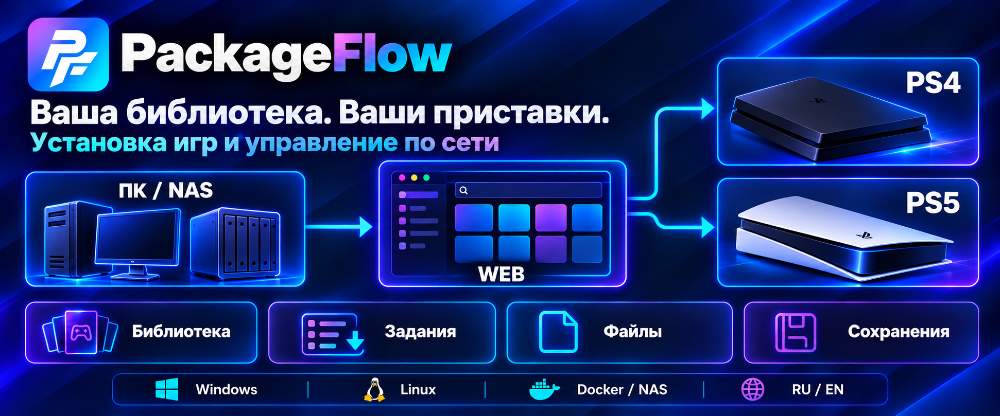
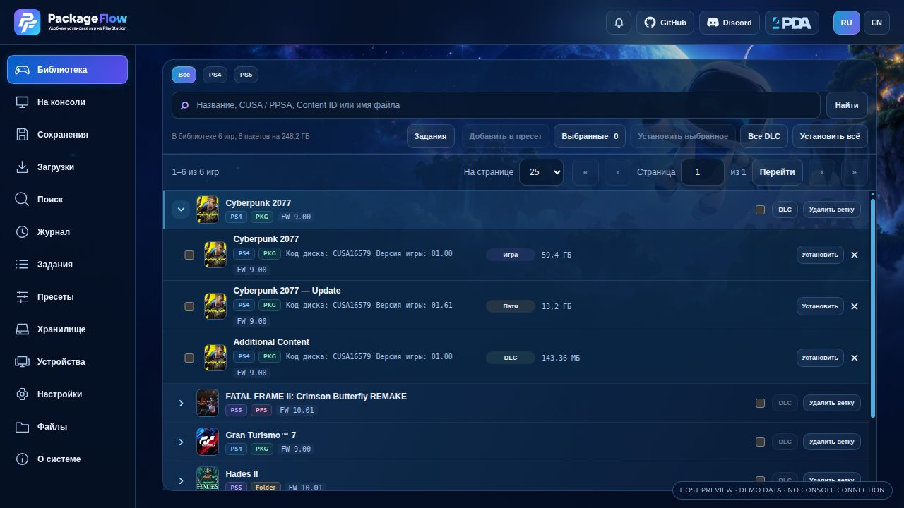

<p align="center">
  <strong>Русский</strong> · <a href="README.en.md">English</a>
</p>

<p align="center">
  
</p>

<h1 align="center">PackageFlow · PS4 / PS5</h1>

<p align="center">
  <strong>Ваша библиотека. Ваши приставки.</strong><br>
  Установка игр, патчей и DLC, очереди устройств, файлы и сохранения —<br>
  из браузера на компьютере или телефоне и из приложения на приставке.
</p>

<p align="center">
  <a href="https://github.com/demagoc3-cpu/playstation_installer/releases/latest"></a>
  
  
  
  <a href="LICENSE"></a>
</p>

<p align="center">
  <a href="https://github.com/demagoc3-cpu/playstation_installer/releases/latest"><strong>Скачать</strong></a> ·
  <a href="#installation">Установка</a> ·
  <a href="#consoles">PS4 и PS5</a> ·
  <a href="#screenshots">Скриншоты</a> ·
  <a href="docs/ru/index.md">Документация</a> ·
  <a href="https://discord.gg/Xj6EPJyAq">Discord</a> ·
  <a href="https://4pda.to/forum/index.php?showtopic=1127073">4PDA</a>
</p>

---

## О проекте

**PackageFlow** объединяет вашу библиотеку на компьютере или NAS и приставки **PlayStation 4 и PlayStation 5**. Добавьте папки с играми, выберите нужные компоненты и получателей — WEB подготовит задания, а служба на каждой приставке выполнит передачу и установку.

Один сервер обслуживает несколько устройств. У каждой приставки собственные очередь, подключение и история; из браузера видно, что происходит на каждой из них. Управлять библиотекой можно с компьютера, телефона или планшета. Приложения на PS4 и PS5 дают доступ к каталогу и заданиям с геймпада.

[](docs/screenshots/readme-20261029/library-ru.jpg)

<sub>Настоящий интерфейс WEB на демонстрационной библиотеке. Нажмите на изображение, чтобы открыть полный размер.</sub>

## Что умеет PackageFlow

| Раздел                      | Возможности                                                                                                                                                                     |
| --------------------------- | ------------------------------------------------------------------------------------------------------------------------------------------------------------------------------- |
| **Библиотека**              | Общий каталог PS4/PS5, обложки и метаданные, поиск, страницы и фильтры. Игра, патчи и DLC собраны вместе. Выбор сохраняется между поиском и страницами.                         |
| **Установка**               | Выбор содержимого и нескольких приставок, проверка совместимости и места, подтверждение переустановки. У PS5 — отдельные маршруты для PKG, Folder и образов.                    |
| **Задания**                 | Независимые очереди устройств, параллельная работа через службы, компактные карточки, прогресс, скорость и оставшееся время, отмена пакета или ветки игры, история.             |
| **Пресеты**                 | Собственные подборки, редактирование состава, установка подборки, импорт и экспорт списка.                                                                                      |
| **Хранилище**               | Локальные каталоги и сетевые источники SMB/NFS/WebDAV, подключение папок, сканирование и переиндексация. Доступные способы подключения зависят от ОС и её компонентов.          |
| **На консоли**              | Каталог установленного содержимого, сведения об играх, запуск, остановка и удаление в пределах возможностей подключённой службы.                                                |
| **Файлы и сохранения**      | Файловые операции PS4; списки сохранений PS4/PS5, резервные копии и восстановление при поддержке соответствующей службы.                                                        |
| **Очистка PS5**             | Просмотр и подтверждённое удаление собственных остатков PackageFlow: незавершённых передач, временных данных и регистраций без файлов. Нужна служба 030j+ с поддержкой очистки. |
| **Поиск и загрузки**        | Необязательная интеграция с Prowlarr/Jackett и qBittorrent, поиск раздач, контроль загрузок и автоустановка на PS4 после скачивания.                                            |
| **Устройства и обновления** | Подключение актуальных служб без кода, управление службой PS5 через PLDMGR, тесты скорости и уведомления о новых релизах PackageFlow.                                           |
| **Русский и английский**    | Переключение языка в интерфейсе и документация на двух языках.                                                                                                                  |

## Как это работает

**Файлы на ПК / NAS → библиотека WEB → очередь выбранной приставки → локальная установка на PS4 / PS5.**

| Компонент               | Его роль                                                                                                                                              |
| ----------------------- | ----------------------------------------------------------------------------------------------------------------------------------------------------- |
| **WEB PackageFlow**     | Каталог, настройки, пресеты, очереди и передача файлов. Работает на Windows, Linux, NAS или из исходников. Это репозиторий WEB и настольных оболочек. |
| **PackageFlow для PS4** | PKG с приложением для геймпада и фоновой службой PackageFlowService.                                                                                  |
| **ELF-служба PS5**      | Фоновая PackageFlowService-PS5.elf для передачи, установки и управления. PKG-маршрут входит в эту службу.                                             |
| **Приложение PS5**      | Отдельный, необязательный FFPKG-клиент библиотеки, пресетов и заданий WEB.                                                                            |

Приставка получает содержимое по локальной сети и устанавливает его на свой накопитель. Компьютер или NAS с WEB должен оставаться включённым и доступным во время задания. NAS служит источником файлов; запуск игр прямо с сетевой папки здесь не заявляется.

<a id="consoles"></a>

## PS4 и PS5: форматы и подключение

| Получатель       | Содержимое                               | Что требуется                                                                                                                        |
| ---------------- | ---------------------------------------- | ------------------------------------------------------------------------------------------------------------------------------------ |
| **PS4**          | PKG для PS4: игры, патчи, DLC и homebrew | Совместимая PS4 с активным GoldHEN и PackageFlowService. Для первоначальной установки службы и отдельной передачи доступен PyLoader. |
| **PS5 · PKG**    | PKG для PS4 и PS5                        | Совместимая среда homebrew и запущенная ELF-служба с готовым PKG-маршрутом.                                                          |
| **PS5 · Folder** | Папка игры                               | ELF-служба и совместимый работающий ShadowMount.                                                                                     |
| **PS5 · образы** | UFS2, exFAT, PFS, FFPFSC                 | ELF-служба и поддерживаемый ею backend ShadowMount; готовность проверяется для каждого формата.                                      |

**PS4 не устанавливает содержимое PS5.** Возможности PS5 определяются ответами работающей службы и готовностью конкретного маршрута. Недоступный ShadowMount относится к Folder/образам; для PKG проверяется собственная готовность.

PackageFlow требует уже подготовленной среды homebrew на приставке. Поддержка формата не гарантирует работу любой прошивки или запуск каждой игры. В окне установки WEB показывает состояние выбранного устройства и причину недоступности.

**Первое подключение:**

1. Установите и запустите PackageFlow на компьютере или NAS.
2. В **«Устройствах»** добавьте PS4 или PS5 и укажите её IP в локальной сети.
3. Подготовьте службу: PKG PackageFlowService для PS4 или ELF-службу для PS5. В настольных сборках доступен комплект файлов для приставок.
4. Выберите **«Сервис → Подключить»**. Актуальные службы подключаются **без шестизначного кода**.
5. Добавьте библиотеку в **«Хранилище»**, выберите игры и проверьте состав и получателей в окне установки.

[Пошаговое подключение PS4 и PS5 →](docs/ru/consoles.md)

<details>
<summary><strong>Зачем PS5 отдельная служба и приложение?</strong></summary>

ELF-служба обеспечивает фоновые операции WEB. Приложение FFPKG открывает каталог, пресеты, избранное и задания на самой PS5. Для управления из браузера устанавливать приложение не требуется; открытое окно приложения не заменяет службу.

Управление запуском и остановкой службы доступно через PLDMGR. Folder и образы используют совместимый ShadowMount. Проверка состояния не отправляет и не запускает ELF автоматически.

Возможности управления установленными играми в WEB и функции приложения с геймпадом различаются. Подробности — в [руководстве подключения](docs/ru/consoles.md).

</details>

<a id="installation"></a>

## Установка

Скачивайте готовые файлы из [GitHub Releases](https://github.com/demagoc3-cpu/playstation_installer/releases/latest). В одном выпуске собраны настольные версии и комплект для приставок.

| Вариант                         | Что скачать                                | Когда выбирать                                                             |
| ------------------------------- | ------------------------------------------ | -------------------------------------------------------------------------- |
| **Windows 10 / 11 x64**         | <code>PackageFlowSetup-…-x64.exe</code>    | Мастер установки, собственный WEB, управление компонентами и трей.         |
| **Linux x64 · Debian / Ubuntu** | <code>packageflow_…_amd64.deb</code>       | Установка через пакетный менеджер, пользовательская служба systemd и трей. |
| **Linux x64 · AppImage**        | <code>PackageFlow-…-x86_64.AppImage</code> | Настольный запуск без DEB-пакета.                                          |
| **Linux / NAS · Docker**        | <code>demagoc3/packageflow</code>          | Фоновый сервер на Linux, NAS или другом хосте amd64/arm64.                 |
| **Исходники**                   | Этот репозиторий + Node.js 22 LTS          | Собственный запуск на Windows, Linux или macOS и разработка.               |

### Windows

1. Запустите EXE из релиза. Node.js, WEB и среда .NET входят в комплект.
2. В мастере подготовьте сервер, укажите каталог библиотеки и проверьте LAN-адрес компьютера.
3. Добавьте приставку и подключите подходящую службу по [инструкции](docs/ru/consoles.md).
4. Откройте WEB из приложения или в браузере: **http://localhost:3000** по умолчанию.

Поиск и торрент-клиент можно настроить позже. Windows-приложение запускает собственный WEB; отдельный Docker для этого не нужен.

### Linux

Для Debian / Ubuntu установите скачанный пакет:

```sh
sudo apt install ./packageflow_ВЕРСИЯ-1_amd64.deb
```

Для AppImage:

```sh
chmod +x PackageFlow-ВЕРСИЯ-x86_64.AppImage
./PackageFlow-ВЕРСИЯ-x86_64.AppImage
```

Замените <code>ВЕРСИЯ</code> на номер из имени скачанного файла. После установки DEB запускайте PackageFlow из меню системы. AppImage сохраните в постоянной папке, например <code>~/Applications</code>, и запускайте этот файл. WEB работает как пользовательская служба systemd; закрытие окна оставляет её работать.

Нужны Python 3, PyGObject/GTK 3 и systemd. Для встроенного окна используется WebKitGTK; доступно открытие в обычном браузере. Если FUSE недоступен, AppImage можно запустить с <code>--appimage-extract-and-run</code>.

[Подробности Linux, службы и трея →](apps/linux-desktop/README.md)

### Docker / NAS

На Linux-хосте подключите папку с играми и отдельный том для данных:

```sh
docker run -d --name packageflow --restart unless-stopped \
  --network host \
  -v packageflow-data:/app/.data \
  -v /path/to/games:/games:ro \
  demagoc3/packageflow:latest
```

Замените <code>/path/to/games</code> своим путём. Откройте **http://IP_СЕРВЕРА:3000** и добавьте источник **/games** в «Хранилище». Для игр на другом NAS сначала обеспечьте доступ к каталогу на хосте, затем передайте его контейнеру.

Используйте доступный приставке LAN-адрес и сохраняйте том <code>/app/.data</code> между обновлениями. Готовый [docker-compose.yml](docker-compose.yml) дополнительно запускает Prowlarr и FlareSolverr; поиск и загрузки остаются необязательными.

[Подробнее о Docker и путях →](docs/ru/docker.md)

<details>
<summary><strong>Запуск из исходников: Windows, Linux и macOS</strong></summary>

Понадобится **Node.js 22 LTS**. Из корня репозитория:

```sh
git clone https://github.com/demagoc3-cpu/playstation_installer.git
cd playstation_installer
npm ci
npm run build
npm start
```

Откройте **http://localhost:3000**. Для разработки используйте <code>npm run dev</code>. Также поддерживаются <code>pnpm install</code>, <code>pnpm build</code> и <code>pnpm start</code>.

Сборка и dev-сервер используют общую <code>.nuxt</code>: готовьте production-сборку в отдельной копии, если в текущем каталоге работает dev-сервер.

</details>

<a id="screenshots"></a>

## Интерфейс

### Задания устройств и подборки

| Очереди PS4 и PS5                                                                                                                                               | Пресеты библиотеки                                                                                                                           |
| --------------------------------------------------------------------------------------------------------------------------------------------------------------- | -------------------------------------------------------------------------------------------------------------------------------------------- |
| [](docs/screenshots/readme-20261029/tasks-ru.jpg) | [](docs/screenshots/readme-20261029/presets-ru.jpg) |

### Управление PS5 в WEB

[](docs/screenshots/readme-20261029/ps5-console-table-ru.jpg)

### На компьютере и на приставке

| Приложение Windows                                                                                                                                           | Приложение PS5                                                                                                                                                                  |
| ------------------------------------------------------------------------------------------------------------------------------------------------------------ | ------------------------------------------------------------------------------------------------------------------------------------------------------------------------------- |
| [](docs/screenshots/readme-20261029/windows-preview.png) | [](docs/screenshots/readme-20261029/ps5-native-preview.png) |

<sub>WEB показан на демонстрационных данных. Windows и PS5 — предпросмотры реальных интерфейсов на компьютере; они не подтверждают аппаратную проверку изображённых сценариев. Скриншоты не нарисованы генератором. [Происхождение изображений](docs/screenshots/readme-20261029/provenance.md).</sub>

## Сохранения, место и обновления

- **Сохранения PS5:** копии контейнеров хранятся на WEB, доступны ZIP и восстановление при поддержке службы. Копии привязаны к своей приставке, пользователю и игре; перенос сохранений на другую PS5 не заявляется.
- **Место в очереди:** «Ждёт установки» показывает полный объём незавершённых пакетов, а свободное место — последнее прочитанное значение. Предупреждение «может не поместиться» является оценкой; перед установкой выполняется собственная проверка.
- **Очистка PS5:** служба повторно проверяет принадлежность и состояние выбранных остатков. Установленные игры и сохранения не входят в список очистки; результат неизвестной операции сверяется перед следующими действиями.
- **Обновления:** колокольчик сообщает о новой версии PackageFlow, а настройки позволяют проверить её вручную или отключить автопроверку. WEB не устанавливает обновление без действия пользователя. Обновления компонентов приставок управляются отдельно.
- **Обновление существующей установки:** дождитесь окончания заданий, сохраните резервную копию данных и установите новую версию поверх. Библиотека, настройки, ключи и очереди хранятся отдельно от файлов программы.

## Где хранятся данные

| Запуск        | Данные WEB                                                                                  |
| ------------- | ------------------------------------------------------------------------------------------- |
| Windows       | <code>%LOCALAPPDATA%/PackageFlow/data/web</code> по умолчанию; можно выбрать другой каталог |
| Linux desktop | <code>~/.local/share/PackageFlow/web</code>                                                 |
| Docker        | <code>/app/.data</code> — сохраняемый том                                                   |
| Из исходников | <code>.data/</code> в корне; можно переопределить через <code>PACKAGEFLOW_DATA_DIR</code>   |

При переносе сервера сохраняйте каталог данных целиком: в нём находятся настройки, индексы библиотеки, подключения и очереди. Исходные файлы игр хранятся в добавленных вами каталогах.

## Документация и поддержка

| Задача                            | Материалы                                                                                                                          |
| --------------------------------- | ---------------------------------------------------------------------------------------------------------------------------------- |
| Подключить PS4 / PS5              | [Актуальное руководство подключения](docs/ru/consoles.md)                                                                          |
| Работать с библиотекой            | [Библиотека и установки](docs/ru/library.md) · [Пресеты](docs/ru/presets.md)                                                       |
| Развернуть WEB                    | [Docker / NAS](docs/ru/docker.md) · [Сборка Windows](packaging/windows/README.md) · [Linux desktop](apps/linux-desktop/README.md)  |
| Настроить поиск и загрузки        | [Torznab](docs/ru/search.md) · [qBittorrent](docs/ru/torrents.md)                                                                  |
| Работать с сохранениями и файлами | [Сохранения](docs/ru/saves.md) · [Файлы PS4](docs/ru/files.md)                                                                     |
| Решить проблему                   | [Диагностика](docs/ru/troubleshooting.md) · [Обновления и данные](docs/ru/updates-data.md)                                         |
| Изучить проект                    | [Документация разработчика](docs/ru/development.md) · [Полное оглавление RU](docs/ru/index.md) · [English guide](docs/en/index.md) |

Вопросы и обсуждение: **[Discord](https://discord.gg/Xj6EPJyAq)** · **[Тема на 4PDA](https://4pda.to/forum/index.php?showtopic=1127073)**.

Нашли ошибку? [Создайте Issue](https://github.com/demagoc3-cpu/playstation_installer/issues) с версиями PackageFlow и службы, типом приставки, форматом содержимого, описанием действий и текстом ошибки из журнала.

<details>
<summary><strong>Разработка и проверки</strong></summary>

```sh
npm test
npm run check
```

Тесты на компьютере и аппаратные проверки на PS4/PS5 имеют разный охват. Для новых маршрутов установки совместимость и результат на приставке подтверждаются отдельно.

</details>

## Лицензия

Собственный код этого публичного репозитория распространяется по [MIT](LICENSE). Консольные компоненты поставляются отдельными файлами в Releases; лицензия WEB не распространяется автоматически на весь комплект.

Сторонние компоненты сохраняют свои лицензии, включая GPL-3.0 у payload DirectPackageInstaller. См. [Third-party notices](THIRD_PARTY_NOTICES.md).

PackageFlow предназначен для собственных резервных копий и homebrew, не распространяет игры и не связан с Sony.

<p align="center">
  <a href="https://github.com/demagoc3-cpu/playstation_installer/releases/latest">Скачать PackageFlow</a> ·
  <a href="README.en.md">Read in English</a>
</p>
