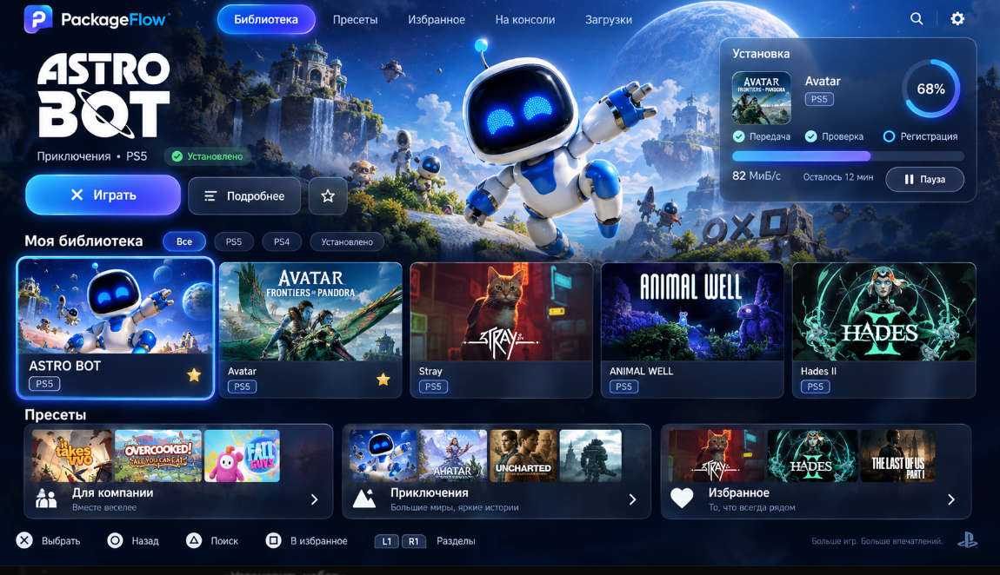
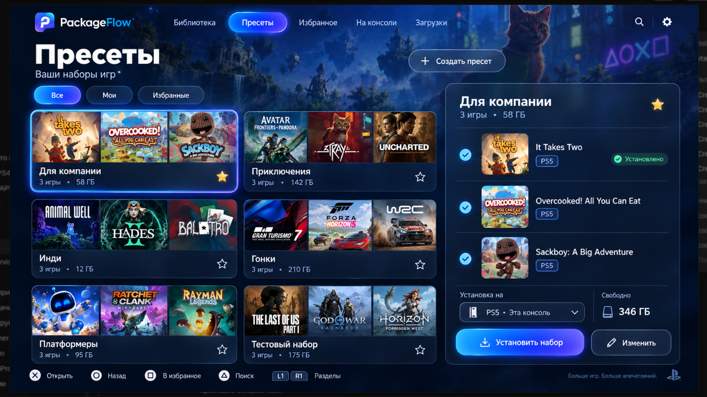
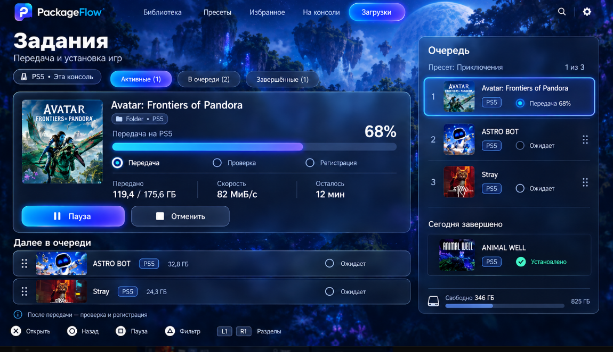

# Codex: полноэкранный PackageFlow Glass для PS5

Задание пользователя от 13 октября 2026 года. Работа над настоящим нативным
приложением PackageFlow PS5. Предыдущий вариант оформления не соответствует
ожиданиям пользователя. Требуется полноценная переработка композиции и удобства,
с сохранением всех существующих функций.

## Твоя роль и ответственность за дизайн

**Ты — оркестратор этой работы и отвечаешь за итоговый дизайн, реализацию и
проверку.** Не перекладывай визуальные решения на пользователя. Сам сопоставляй
реальный интерфейс с приложенными скриншотами и исправляй расхождения.

**Если не хватает макета раздела, окна, состояния или фоновой графики — нарисуй
его самостоятельно в том же стиле.** Для растровых иллюстраций/макетов используй
доступный imagegen skill; настоящие элементы интерфейса реализуй средствами
приложения. Применяй существующие логотипы PackageFlow без перерисовки.

Можно делегировать ограниченные подзадачи агентам при соблюдении владения файлами.
Ты остаёшься ответственным за интеграцию, отсутствие регрессий и визуальное качество.
Подготовка задания не запускает Claude: пользователь передаёт эту работу новому
чату Codex. Это разрешённая пользователем смена исполнителя native-ui относительно
старого распределения в AGENTS.md.

## Проект и границы

- Основной проект: `/home/developer/projects/PS/PackageFlowService-PS5`.
- Приложение: `/home/developer/projects/PS/PackageFlowService-PS5/experiments/native-ui`.
- Исходная реализованная версия Glass: коммит `b10e1ac`; Title ID `PPSA95001`,
  название PackageFlow, метаданные `01.000.042`. Сначала проверь текущий HEAD и
  незакоммиченные изменения; не откатывай чужую работу к названному коммиту.
- Прочитай применимые AGENTS.md, README native-ui, текущие API-контракты,
  `/home/developer/projects/PS/tests/CLAUDE-TASK.md`, CODEX-REPORT.md и конец PS5-TESTS.md.
- Предыдущая спецификация:
  `/home/developer/projects/web/playstation_installer/docs/design/packageflow-glass-20261013/DESIGN.md`.
  Данное задание уточняет требуемую полноэкранную композицию и визуальную проверку.
- WEB, Windows, PS4 и основной root ELF
  `/home/developer/projects/PS/PackageFlowPayload-PS5` этим заданием не переделывать.
  Общий WEB остаётся один для PS4 и PS5.
- Не менять Sony ABI, сопряжение, транспорт, сетевые оптимизации, обработку
  неизвестных результатов, действующие маршруты установки и отметки квалификации.
- Работа должна остаться в настоящем native-ui. Отдельный красивый demo,
  браузерная страница или картинка вместо работающего приложения задачу не выполняют.
- Не коммитить и не пушить WEB-репозиторий. Новые исходники приложения коммитить
  отдельно в native-репозитории после проверки; push и публикация релиза не входят
  в это задание. Собрать отдельный кандидат, сохранив стабильные артефакты.

## Обязательные визуальные ориентиры

Открой и посмотри все три изображения, а не только подписи:

### Библиотека

### Пресеты

### Задания

Изображения лежат в
`/home/developer/projects/web/playstation_installer/docs/design/ps5-native-redesign-20261013/references/`.

Нужны крупные обложки, атмосферный фон на весь экран, тонированные полупрозрачные
карточки, глубина, мягкий blur, сине-фиолетовый акцент и заметный фокус DualSense.
Одной замены цветов и добавления размытой миниатюры недостаточно.

Тексты, размеры, скорости, состав игр и кнопки на макетах иллюстративны. Реальные
значения и доступность действий берутся из приложения/API. Слово «Загрузки» над
заданиями на одном референсе не повод объединять эти два существующих раздела.
Неверный знак P и чужие декоративные марки с макетов не переносить.

## Полноэкранная композиция и управление

- Базовый layout 1920×1080, масштабирование под реальный VideoOut. Фон до краёв
  экрана; без внешней рамки, вложенного маленького окна и широких пустых полей.
  Содержимое имеет умеренные безопасные отступы для телевизора.
- Верхняя навигация, большой основной контент, компактная нижняя строка подсказок
  DualSense. Все десять разделов доступны. Если они не помещаются, используй
  перелистываемую верхнюю навигацию с понятным текущим разделом; не мельчи надписи.
- Крупный текст для телевизора: основной ориентир 22–26 px, заголовки 36–52 px.
  Длинные названия, русские строки и пути не перекрывают соседние действия.
- Прозрачность показывает фон, но сохраняет читаемость. Ориентиры палитры:
  фон #071122/#0B1730, стекло rgba(18,34,61,.75–.88), акцент #35C9FF → #7863FF.
  Мягкая светлая граница, радиусы примерно 16–24 px; свечение преимущественно
  у фокуса и основного действия. Стекло должно выглядеть объёмным, а не плоским
  синим прямоугольником.
- Крестовина/стик, X, круг, треугольник, квадрат, Options, L1/R1 и остальные
  существующие сочетания сохраняются. Фокус однозначен и виден на расстоянии.
  Возврат из карточки/окна сохраняет выбранный элемент и позицию прокрутки.
- Главное действие и вторичные действия доступны контроллером. Не рисуй кнопки,
  до которых нельзя добраться. Подсказки соответствуют реальному текущему экрану.
- Нет сети, диска и декодирования изображений в frame. Blur и artwork кешируются,
  память ограничена; медленный WEB не замораживает ввод и отрисовку. Цель 60 fps
  требует отдельного аппаратного подтверждения.

## Дизайн всех разделов

Фактический порядок `ui_menu_order`: **Каталог, Избранное, Пресеты, Задания,
Загрузки, Файлы, На консоли, Настройки, Подключения, Поддержать**.

| Раздел | Требуемая композиция |
|---|---|
| Каталог | Большая hero-зона выбранной игры с качественным artwork, названием и реальными действиями; ниже крупные обложки, фильтры и вход в пресеты. Пустую правую карточку «Установка» не показывать: только реальная активная операция, иначе полезные сведения. Сохранить виды 10/20/30/таблица. |
| Избранное | Та же система карточек и hero, доступный поиск, удаление из избранного, пустое состояние. Существующее локальное избранное сохраняется. |
| Пресеты | Как референс: крупные карточки с коллажем обложек, названием и реальным составом/объёмом; справа панель выбранного набора с играми и доступными действиями. Не выдумывать создание/редактирование на консоли, если это доступно только в WEB. |
| Задания | Как референс: большая карточка активной передачи, обложка, стадия, процент, байты, скорость и остаток при наличии данных; компактные следующие строки; справа очередь/завершения. Сохранить историю, фильтры, страницы и доступные команды. |
| Загрузки | Отдельный экран существующих загрузок: прозрачные строки/карточки, реальный статус подключения и действий; доступная диагностика вместо фиктивной торрент-таблицы. |
| Файлы | Полноэкранная читаемая навигация: текущий путь, список, сведения и доступные операции. Чётко различать WEB-источники и файлы PS5. |
| На консоли | Крупные карточки/список установленного содержимого и сведения. Доступные команды — по текущему контракту, ограничения видны. Не подменять список библиотеки компьютера установленными играми. |
| Настройки | Стеклянные группы, крупные значения и переключатели, системная клавиатура, диагностика и «О приложении». Все существующие настройки доступны. |
| Подключения | Понятный статус службы/WEB/сопряжения, реальные адреса, состояния ожидания/ошибки/занятости и действующие команды. Без старого ручного кода сопряжения. |
| Поддержать | Настоящий бренд, имеющиеся адреса/сети/QR и управление контроллером. Не генерировать новые реквизиты. |

Переоформи также карточку игры, состав пакетов, install-review, подтверждения,
фильтры, поиск, fallback-клавиатуру, обновление, безопасное закрытие, ошибки и
loading/empty/offline/stale/busy/unsupported/unknown. Не ограничивайся тремя
референсными экранами. Недостающие макеты и графику разработай самостоятельно.

## Сохранение функций — критерий приёмки

До правок составь таблицу «функция → текущий обработчик/API → новый путь в UI →
проверка». Используй настоящий код как источник списка; устаревшее README не
служит основанием выключать работающую функцию.

Обязательно сохранить:

1. Каталог v2, consoleId/platform/schema, полную пагинацию, виды, поиск/IME,
   фильтры/сортировку, ветки игры/патчей/DLC, карточки и все варианты выбора.
2. Избранное, его существующий лимит/хранилище; пресеты, состав, доступность,
   установку и все уже реализованные переходы.
3. Установку всех реально объявленных форматов: PKG, Folder и поддерживаемые
   образы через их действующие маршруты. Не возвращать ограничение «только PKG».
   Несовместимость и готовность проверять по API, не по картинке.
4. Read-only install-preview, точные packageIds, явное подтверждение
   переустановки, проверку места там, где маршрут её поддерживает, устойчивый
   requestId и отсутствие повторного POST после неопределённого результата.
5. Задания с настоящими стадиями, скоростью, историей, фильтрами/страницами,
   идентификаторами queue/package/branch, отменой и удалением доступных записей.
   Пауза/перестановка показаны как действия только при наличии рабочего backend.
   Принятый запрос и 100% передачи не означают подтверждённую установку.
6. Все остальные текущие разделы, настройки /download0, язык, quiet start,
   атомарное сохранение, диагностику, версию, поддержку и ограничения.
7. Автоматическую привязку к WEB через loopback ui/status, generation guards
   при смене подключения/обложек и отсутствие сервисного Bearer в приложении.
8. Worker/update/IME handshake, безопасную парковку при закрытии, VideoOut,
   direct-memory буферы, bounded caches и nonblocking sockets. Не возвращать
   прежние ошибки запуска увеличением статической памяти или изменением ABI.

На референсе есть «Играть», но native README отмечает отсутствие такого обработчика.
Сначала проверь фактический код: существующую рабочую функцию сохрани; если её нет,
главное действие ведёт в сведения/установку по действующему контракту. Новый запуск
из приложения не добавлять незаметно под видом редизайна. То же относится к
регистрации, правам 777 и редактору образов.

## Бренд и художественные материалы

Используй оригиналы:

- `experiments/native-ui/src/ps4-style/brand-data.h`;
- `experiments/native-ui/sce_sys/icon0.png`;
- `/home/developer/projects/PS/PackageFlowService/ui/assets/packageflow-ru.png`
  и `packageflow-en.png`;
- сверка: `docs/design/packageflow-glass-20261013/official-icon.png`
  и `official-wordmark-ru.png` в WEB-проекте.

Графика выбранной игры должна оставаться узнаваемой и качественной. Не растягивай
маленькую обложку до грязного фона на весь телевизор: используй подходящий artwork,
если он доступен по существующему источнику, либо собственный качественный общий
атмосферный фон с корректно размещённой обложкой. Отсутствующий artwork не мешает
работе. Сгенерированные ресурсы сохраняй с промптами и учётом памяти/сборки;
референсные обложки и значения не становятся hardcoded библиотекой.

## Порядок выполнения и доказательства

1. Прочитать исходники, baseline-тесты, составить инвентаризацию функций.
   Открыть референсы и снять текущий реальный UI для сравнения.
2. Спроектировать единые размеры/компоненты/фокус и недостающие экраны. Затем
   реализовать библиотеку внутри приложения как проверку композиции и рендера.
3. Получить снимок именно нового renderer. Сверить масштаб, обложки, стекло,
   полноэкранность и навигацию с референсом; устранить отличия. Не останавливаться
   на первом формально работающем варианте.
4. Перевести все разделы и окна. Прогнать реальные данные и явно обозначенные
   изолированные fixtures: длинные списки/названия, пусто, offline, медленная сеть,
   активная операция, неизвестный результат. Production .data не подменять.
5. Запустить прежние host-тесты, нужные regression-проверки управления/функций,
   сборку SDK и test-native-imports. Старые тесты не удалять ради зелёного результата.
6. Сохранить реальные снимки всех десяти разделов и основных окон, а также
   сравнение «референс → реализовано». У каждого снимка указать renderer, разрешение,
   данные (реальные/fixture) и способ получения. Картинки imagegen не являются
   доказательством реализации; аппаратный fps не заявлять по host preview.
7. Собрать отдельный кандидат с прежними Title ID/Content ID, указать build ID,
   SHA256 и путь. Согласовать номер кандидата с координирующим чатом. Аппаратную
   установку делать только в согласованное окно, прочитав общий журнал; не мешать
   текущим испытаниям и не загружать дополнительные kstuff/ShadowMount.

Текущее аппаратное состояние: PS5 Slim 13.60, 192.168.0.127. Native b10e1ac
запускается. Повторный запуск значком PS5 восстановлен штатным перезапуском
ShadowMountPlus: PID 97 → 158; пользователь подтвердил два запуска с закрытием.
Размонтирование после выхода штатно; не включать постоянное монтирование всей
библиотеки и не менять нагрузки ради дизайна. Эти данные перепроверить перед
новым аппаратным действием, они не обещают неизменный текущий online-статус.

Финальный отчёт: список изменённых файлов, таблица сохранённых функций, реальные
скриншоты всех разделов, тесты с результатами, отдельно host/SDK/hardware,
путь кандидата/хеши и оставшиеся ограничения. Визуальную неполноту обозначать
прямо: «готово» только когда весь интерфейс выдержан в стиле референсов и
существующий функционал сохранён.
