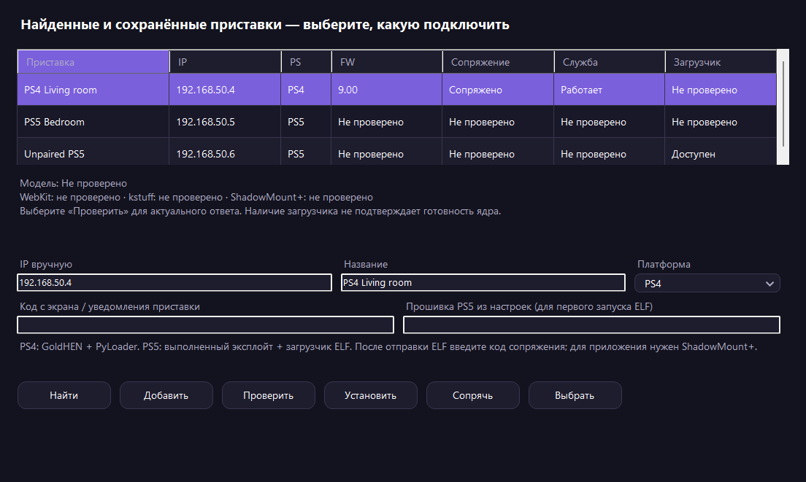

# Windows / WEB: кандидат настройки PS4 и PS5, 11 октября 2026

Реализация: локальный коммит `6882efd`, ветка `codex/multi-console-ps5`.
Публикации, push и новых передач на PS5 не было. Нативные приложения PS4/PS5
в этой работе не менялись; следующий комплект запрошен у Claude заданием 021.

## Фактически выполнено

- .NET 8.0.425: Core tests PASS, сборка Windows и самодостаточного UI-теста
  PASS без предупреждений. Предыдущие настройки PS4 сохраняются.
- Production Nuxt build PASS. Node 24: 28/28 целевых тестов, включая реальные
  HTTP-маршруты Nuxt с синтетическими консолями, новые метаданные v1,
  authorization/Origin, исходный PARAM, SHA256, изменение кэшированного файла,
  однократную отправку ELF и отказ при невозможности записать sending intent.
- Windows 11 Pro `10.0.26300`: настоящий тест WinForms в интерактивной сессии,
  итог LastTaskResult=0. Новый список PS4/PS5 показан на fixture-профилях;
  это не аппаратный тест обнаружения приставок в LAN.
- Окно проверено при двух размерах; поля внутри своих родителей, столбцы,
  неизвестная прошивка отключённой PS5, сохранённые и несопряжённые строки.
- Основной мастер: 20 выборов меню, смена языка с сохранением полей, скрытие
  пароля, четыре размера окна, перерисовка после перемещения и Windows DPAPI.
- Упакованные Windows Node `22.23.3` и WEB реально запущены через ServerHost
  с временными данными и свободными портами: новый каталог, пустые профили,
  недоступность setup API без launcher key, штатная остановка — PASS.
- Временная интерактивная задача удалена после завершения; тестовые данные
  удалены. Рабочее приложение, реестр автозапуска и настройки пользователя
  тестом не заменялись. В Downloads оставлены отчёты и кандидат EXE.

Исправления, найденные на Windows: повторный Dispose окна больше не вызывает
ObjectDisposedException; вложенные строки полей имеют явную высоту, поэтому
поле платформы не обрезается; заголовки таблицы помещаются; список платформы
полностью перерисовывается при изменении ширины. Окно открывается с учётом
рабочей области экрана.

Старая проверка qBittorrent ожидала кнопку выбора локальной папки, уже убранную
раньше. Она актуализирована для существующего поля сопоставления пути.
HTTP-тест теперь ждёт фактическую отправку фоновой очередью: принятие команды
само по себе ещё не означает, что POST установки уже выполнен.

Снимок реального окна на fixture-данных:

## Собранный артефакт

`dist/windows/PackageFlowSetup-1.10.8-x64.exe`, 89 470 058 байт.
SHA256 `45f32611985cd060035e3643fabbb8dc2f9bdeee8a66ed7f91f49aeae469b1f0`.
NSIS 3.10, локальный кандидат, не опубликованный релиз. Передан в отдельную
папку Downloads тестового Windows-компьютера; автоматически не установлен.
NSIS installer/uninstaller на Windows этим испытанием не запускались.

В этом EXE **нет нового бинарного комплекта PS5**: мастер явно сообщает это
и не отправляет ELF/приложение. Для следующей упаковки нужны нативные артефакты
Claude 021, сверка манифеста и аппаратное испытание полного сценария.

Docker на Windows не установлен: живой Compose-тест здесь не проводился.
Общие правила staging комплекта и Compose paths проверены Core-тестами;
это не подтверждение работы контейнеров на этом компьютере.

## Следующие шаги

1. Claude читает `CLAUDE-TASK-PS-APPS-021.md`: PS4 2.05, PS5 01.000.041,
   постоянные Title ID, имя PackageFlow, новые детали/фильтр v1 и отсутствие
   адреса стенда в релизном клиенте.
2. Проверить возвращённые папку/образ, PARAM и хеши, собрать полный manifest
   вместе с проверенным ELF; пересобрать Windows-кандидат.
3. Испытать первоначальную установку на доступной PS5 13.60 и отдельно
   режим Compose в среде с Docker. Не считать предыдущие тесты отдельных
   форматов подтверждением полного нового мастера.
